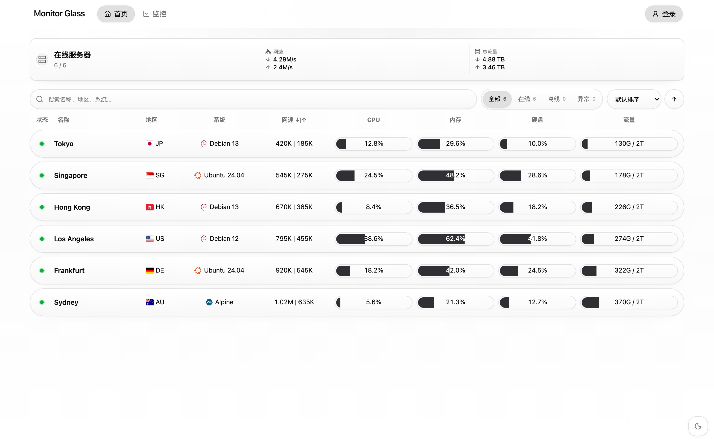

# Monitor Glass

简洁的 [Monitor](https://github.com/monitor-probe/monitor) 公开状态页主题，支持深浅色、移动端和历史图表。当前版本 **v1.3.1**，适配 Monitor Hub **v1.4.1**。

## 安装

1. 打开 Monitor 后台的「主题」页。
2. 在「从 GitHub 安装」中填入 `https://github.com/wxte/Monitor-Glass` 并安装。
3. 将 Monitor Glass 设为当前主题。

也可以从 [Releases](https://github.com/wxte/Monitor-Glass/releases/latest) 下载 `theme.tar.gz`，在主题页上传安装。

## 更新

在 Monitor 后台的「主题」页更新 Monitor Glass；更新后刷新公开状态页即可。

## 许可证

[MIT](LICENSE)。第三方资源说明见 [THIRD_PARTY_NOTICES.md](THIRD_PARTY_NOTICES.md)。
